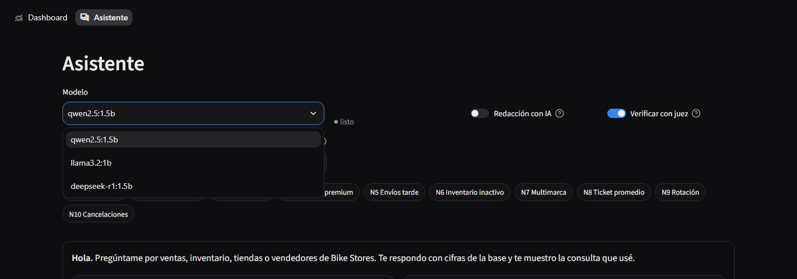
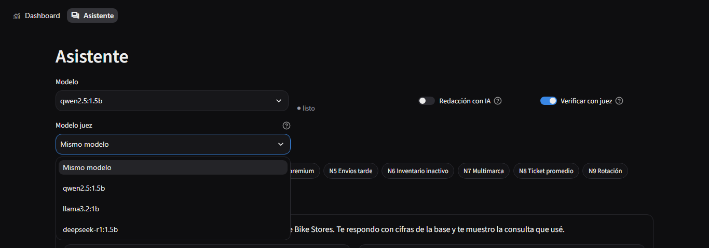

# Fase 10: restringir modelos, no filtrar SQL resuelta, corregir sumas en la síntesis

Modelo usado en las pruebas reales: **qwen2.5:1.5b**. No se usó ningún otro.

## 1. Selectores: solo los 3 modelos soportados

`views/asistente.py`: el selector **"Modelo"** ahora lista únicamente `config.SUPPORTED_MODELS`.
Antes también agregaba cualquier modelo instalado. El selector **"Modelo juez"** ya estaba
restringido.

Si un modelo soportado no está descargado, se sigue mostrando con «↓ no descargado». Si la sesión
traía un modelo fuera de la lista como activo, vuelve a `qwen2.5:1.5b`.

En esta máquina Ollama tiene **6 modelos instalados**: `qwen3:4b`, `llama3.2:3b`, `qwen2.5:7b`,
`deepseek-r1:1.5b`, `llama3.2:1b` y `qwen2.5:1.5b`. Los dos selectores, desplegados contra la app
real, ofrecen:

- Modelo: `qwen2.5:1.5b`, `llama3.2:1b`, `deepseek-r1:1.5b`
- Modelo juez: `Mismo modelo`, `qwen2.5:1.5b`, `llama3.2:1b`, `deepseek-r1:1.5b`




Pruebas: con 5 modelos locales simulados (incluidos `qwen3:4b` y `qwen2.5:7b`) los dos selectores
solo ofrecen los 3 de la lista, y un modelo activo no soportado vuelve al de por defecto.

## 2. El juez no entrega SQL resuelta

- **Prompt** (`judge.CRITIC_SYSTEM`): pide explicar en prosa qué está mal y «NUNCA escribas un
  bloque de código ni una consulta SQL, ni completa ni corregida, ni fragmentos que empiecen con
  SELECT: el otro modelo debe escribir la corrección».
- **Filtro** (`feedback.strip_sql`), porque los modelos chicos no siempre obedecen. Se aplica a
  toda crítica antes del siguiente intento, con o sin referencia; con referencia, además,
  `sanitize` quita cifras y textos de la respuesta. Quita:
  - los bloques de código,
  - el código en línea que contiene SQL,
  - las líneas que empiezan como consulta (SELECT, WITH, FROM, WHERE, GROUP BY…),
  - las consultas escritas en medio de una frase.

  Un nombre de columna entre comillas invertidas, como `store_name`, se conserva sin las
  comillas: es diagnóstico, no una corrección lista para copiar.

**Ejemplo real** (`python tools/demo_fase10.py` → `docs/fase10_demo.json`). Se le pidió la
crítica al juez para 4 intentos fallidos reales. En **1 de 4 (N3)** devolvió la consulta
corregida, aunque el prompt lo prohíbe.

- *Crítica en bruto (N3):* «La consulta está mal porque no se está agrupando por el vendedor…
  Por lo tanto, la consulta debería ser:» seguida de un bloque ```sql con
  `SELECT staff_name AS vendedor, SUM(net_amount) AS ingreso FROM v_order_lines WHERE
  order_status = 4 GROUP BY staff_name`.
- *Lo que llega al siguiente intento:* «La consulta está mal porque no se está agrupando por el
  vendedor, sino por el ingreso neto. Además, se está filtrando por la marca 'Electric Bikes' en
  lugar de filtrar por el estado '[…]' (completado). Por lo tanto, la consulta debería ser:».
  Sin SQL y sin cifras.

La calidad del juez sigue siendo la de un modelo de 1.5B:
- en N3 propone quitar el filtro de Electric Bikes, que es justo lo que pide la pregunta;
- en N5 afirma que `is_late` no existe en `v_orders`, y sí existe.

Eso no cambia: el juez solo aconseja y el veredicto sigue siendo del comparador.

Prueba: un juez falso devuelve un bloque ```sql, código en línea y una consulta en su propia
línea. El feedback que llega al siguiente intento no contiene ningún SELECT ni bloque de código
(con y sin referencia).

## 3. La síntesis suma TODAS las filas (bug de N6)

**El bug:** a la "Redacción con IA" se le pasan las primeras 15 filas. Cuando la pregunta pide un
total, el LLM lo "calculaba" con lo que veía, o lo inventaba.

**La corrección** está en `sql_engine.synthesize`, que usan todas las rutas: verificada con
Redacción con IA, llm, llm_anclada y el modo juez.

1. `wants_total(pregunta)`: ¿la pregunta pide un total? Detecta "total", "suma", "en conjunto",
   "cuánto dinero / capital / cuesta / perdimos / unidades…". Los promedios ("en promedio",
   "ticket") no cuentan, salvo que digan "total" explícitamente.
2. `compute_totals(pregunta, df)`: **total_real con pandas sobre el DataFrame completo**, para las
   columnas sumables (excluye promedios, %, tasas, precios unitarios, rankings, ids, días).
   - Si el resultado ya trae una fila «Total», como N5 y N10, se usa esa fila: sumar contaría dos
     veces el total y los desgloses.
3. El prompt recibe «El total ya viene calculado en total_real sobre TODAS las filas (no solo las
   que se muestran): úsalo tal cual, no lo recalcules y no inventes una suma distinta», con cada
   `total_real` ya formateado.
4. `enforce_totals`, la red de seguridad:
   - si el texto afirma un total ("total", "suman", "asciende a", "en conjunto"…) con una cifra
     distinta de total_real, la sustituye;
   - si no menciona total_real en absoluto, agrega «El total real es $X.».

   El número final siempre lo pone Python.

**N6 repetido con qwen2.5:1.5b** (datos actuales: **29 filas**, de las que el LLM ve 15):

| | Valor inmovilizado |
|---|---|
| total_real (29 filas, pandas) | **$1,891,217.66** (1,234 unidades) |
| suma de las 15 filas mostradas | $1,679,403.71 |
| **Antes** (prompt sin total_real) | «…cuyo valor total en inmovilización es de **$1,234,567.21**». Ni siquiera es la suma parcial: es una cifra inventada. |
| **Ahora** | «Por lo tanto, tenemos 29 productos en bodega que llevan meses sin moverse, cuyo valor total en inmovilización es de **$1,891,217.66**». |

Con total_real en el prompt, el propio LLM ya escribió $1,891,217.66: lo comprobé llamándolo sin
la red de seguridad. `enforce_totals` queda para cuando no obedezca.

Pruebas (`tests/test_fase10.py`):
- **DataFrame de 8 filas** con total conocido ($36,000.75) y un LLM falso que suma mal ($6,000.75,
  "60 unidades"): el texto final dice $36,000.75 y 360, y no la suma parcial.
- Si el LLM omite el total, se agrega.
- No se agregan totales a promedios ni rankings.
- N10 usa su fila «Total».
- **N6 por las rutas verificada (con Redacción con IA) y LLM libre:** las dos terminan con el
  total real y no con el de las 15 filas.

**Límite conocido:** `enforce_totals` solo corrige cifras que el texto presenta como total. Si el
LLM inventa otra cifra que no sea un total (por ejemplo, un máximo mal leído), no se detecta.
Para eso sigue existiendo la respuesta determinística sin "Redacción con IA", que es la opción
por defecto.

## Verificación

- `pytest -q`: **358 passed** (12 nuevas).
- Comportamiento por defecto sin cambios: con "Redacción con IA" apagado, la ruta verificada
  sigue respondiendo con la frase determinística, sin LLM y en <0.1 s.

## Archivos

- `views/asistente.py`: selectores.
- `judge.py`: prompt del juez.
- `feedback.py`: `strip_sql`.
- `sql_engine.py`: `wants_total`, `compute_totals`, `enforce_totals` y la síntesis.
- `tests/test_fase10.py`: 12 pruebas.
- `tools/demo_fase10.py`, `tools/capturas_fase10.py`.
- `docs/fase10_demo.json`, `docs/capturas/fase10_*.png`.
