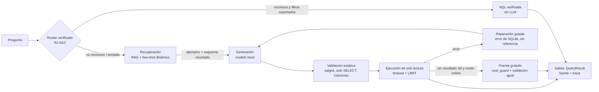

# Fase 11: necesidades negativas, few-shot, RAG y harness (modo local offline y modo online gratis)

Rama: `feat/necesidades-negativas-fewshot-rag-harness-offline-online` (partió de `v4`).
Modelo con el que se midió todo: **`qwen2.5:1.5b`**. Los otros dos modelos permitidos
(`llama3.2:1b`, `deepseek-r1:1.5b`) **no estaban descargados** en esta máquina y se decidió no
descargarlos: la tabla es de un solo modelo (ver §6 y §12).

## 1. Qué pidió el profesor y cómo se interpretó

| Frase del profesor | Interpretación implementada |
|---|---|
| "Necesidades negativas" | Variantes de cada necesidad N1-N10 que se parecen a ella: paráfrasis, otros filtros, otra métrica, **casi-iguales con trampa** (se parecen pero exigen otra SQL), ruido ortográfico y preguntas ambiguas con una suposición documentada. Son "negativas" porque enseñan el límite: no basta con reconocer la forma. |
| "Montar ejemplos resueltos" (few shot) | Un catálogo versionado (`necesidades_negativas/catalogo.jsonl`) con pregunta + SQL validada; los más parecidos a la pregunta entran al prompt del modelo local (`fewshot.py`). |
| "Que reconozca que se parece a una que ya le hicieron" | Recuperación léxica (`rag.py`): TF-IDF con n-gramas de palabra y de carácter, sin modelos de embeddings, con umbral y traza visible. |
| "Harness" | `harness.py`: pipeline determinista con etapas trazadas (ruteo, recuperación, generación, validación estática, ejecución, reparación, consistencia, escalamiento). |
| "Puente" hacia un modelo grande | `bridge.py`: interfaz opcional a un proveedor de **capa gratuita** con API compatible con OpenAI, protegida por `cost_guard.py`. Apagada por defecto; no expone puertos ni túneles. |

## 2. Arquitectura



Etiquetas de fuente visibles en el Asistente: `Verificada`, `IA anclada`, `Generada por IA`,
**`IA + ejemplos`** y **`Generada por modelo grande (online)`**.

Archivos nuevos: `necesidades_negativas/` (catálogo, validador, importador, generador),
`scripts/` (4 CLIs), `fewshot.py`, `rag.py`, `context_modes.py`, `harness.py`, `netmode.py`,
`cost_guard.py`, `bridge.py`, `bridge_providers.yaml`, `.env.example`, `eval_fase11.py`,
`views/comparativa_fase11.py`. Cambios en código existente, todos opt-in: `sql_engine.py`
(`modo_contexto`, `contexto_opts`, `sql_check`, `sql_options`; el prompt base es idéntico, hay una
prueba), `config.py`, `views/asistente.py`, `app.py`, `learned_patterns.py`.

## 3. Modos de red: Local offline vs Online gratis

| | **Local offline** (por defecto) | **Online gratis** (opt-in) |
|---|---|---|
| Red | Ninguna conexión hacia fuera; solo Ollama en localhost | Solo el puente, hacia un proveedor de la allowlist |
| Costo | Cero | Cero (ver §11 y la garantía de abajo) |
| Qué usa | Los 3 modelos locales + catálogo versionado | Igual, y escala al puente solo si el local no logra nada útil |
| Se activa con | `IAF_MODO_RED=offline` (o nada) | `IAF_MODO_RED=online` + `IAF_BRIDGE_ENABLED=1` + llave en `.env`, o el radio del Asistente |

**Garantía de costo cero.** `cost_guard.py` rechaza, antes de cada petición: proveedor fuera de la
allowlist o deshabilitado; modelo fuera de `modelos_gratuitos` (y, en OpenRouter, sin sufijo `:free`);
llaves con formato de servicios de pago; y todo si una respuesta anterior mostró un posible cobro
(402, `usage.cost > 0`, mensajes de billing: interruptor persistente hasta `reset()`). Además: tope local
(5 por minuto y 100 por día, persistente en `.cache/`), caché en disco por hash (una consulta idéntica
nunca se repite en red), backoff ante 429/5xx con máximo 3 intentos, y degradación a offline sin error
cuando se agota la cuota o falla la red. Solo se envían el esquema, las reglas y las preguntas del
catálogo; nunca filas de la base.

**Cómo se comprueba el modo offline.** `netmode.require_online()` lanza `OfflineError` en offline y
`netmode.block_external_sockets()` intercepta `socket` (conexión y DNS) y registra cualquier destino que no
sea local. La evaluación corre dentro de ese guardia: **conexiones externas intentadas = 0** (consta
en `eval/fase11/resultados.json` y en la tabla). Una prueba hace lo mismo con el chat completo en los
cuatro modos.

## 4. El catálogo de necesidades negativas

Cómo se generó (todo validado por el mismo `validador.py`; sin `validado: true` no entra):

| Quién resolvió | Ejemplos | Cómo |
|---|---:|---|
| `claude-code` (Claude Code actuando como modelo grande) | 90 | Redactados a mano: 9 por necesidad. Las paráfrasis/ruido/ambiguas reutilizan la SQL verificada (`sql_desde`); 40 SQL (agregado distinto y trampas) escritas a mano. |
| `plantilla` (sin red, `scripts/generar_negativas.py --modo plantilla`) | 48 | Filtros por tienda/año/rango con `render_sql` + una variante con ruido por necesidad. 2 de 50 se rechazaron: el filtro no cambiaba el resultado. |
| `modelo-grande-manual` / `modelo-grande-online` | 0 | Los scripts existen (`preparar_lote_para_modelo_grande.py`, `importar_resueltas.py`, `generar_negativas.py --modo api`) y se probaron con datos simulados; no se usaron. |

Total **138**. Por necesidad: N1 14, N2 13, N3 14, N4 13, N5 14, N6 14, N7 14, N8 14, N9 14, N10 14.
Por tipo: filtro_distinto 38, parafrasis 30, agregado_distinto 20, casi_igual_trampa 20, ruido 20,
ambigua 10. Split determinista (hash del id): **93 train / 45 heldout**.

Validación (`scripts/validar_catalogo.py`, 0 inválidas): solo SELECT/WITH, `sqlglot` (sqlite), un solo
statement, tablas existentes, ejecución en `mode=ro` con timeout, ≥ 1 fila (o `espera_vacio` con
motivo), y el **comparador** frente al resultado de la necesidad base: `igual` para paráfrasis y ruido,
`distinta` para agregados y trampas. Al construirlo, el validador cazó tres problemas de mis ejemplos (una consulta con 0 filas y dos "agregados/trampas" que daban el mismo resultado que la necesidad base: en este dataset **cada cliente tiene exactamente un pedido completado**, así que "promedio por cliente" = "promedio por orden") y un error del propio validador (el criterio del golden del ítem A3 pisaba al de N3). Se corrigieron.

Detalles que conviene saber: la semilla del split (`iaf-fase11-s86`) se eligió entre 100 candidatas por
balance 70/30 por necesidad, sin mirar ningún resultado; ninguna pregunta del catálogo coincide con una
del golden (el importador la rechaza); agregar ejemplos es `python scripts/importar_resueltas.py archivo.json --por claude-code`.

## 5. Few-shot vs RAG vs Harness

| | Few-shot (`fewshot.py`) | RAG (`rag.py`) | Harness (`harness.py`) |
|---|---|---|---|
| Qué inyecta | k ejemplos del catálogo (`train`) **después** de los de producción | Ejemplos sobre `RAG_MIN_SCORE` de catálogo + necesidades verificadas + patrones aprobados, **y** esquema recortado a lo relevante | Lo del RAG, completado con few-shot dinámico |
| Si nada se parece | Igual entrega k (más parecidos) | No inyecta nada: prompt idéntico al base | Igual que RAG |
| Variantes | dinámico (por pregunta) y estático (los mismos k fijos, uno por necesidad) | — | `harness_router`: con el enrutador verificado delante |
| Trazabilidad | ids de ejemplos | ids + puntaje + si recortó el esquema | Etapas completas |
| Extra | — | — | Validación estática de **columnas inventadas** (con la lista de columnas válidas en el mensaje de reparación), reparación, consistencia opcional, escalamiento opcional |

Presupuesto de contexto: `FEWSHOT_MAX_CHARS = 2400` (~700 tokens) para no desbordar `num_ctx = 4096`.

## 6. Resultados reales (qwen2.5:1.5b, offline, temperatura 0, 2 intentos)

Experimento: `eval_fase11.py`, 828 corridas en ~17 min (`eval/fase11/`: `resultados.json`, `.csv`,
`tabla_comparativa.md`, `grafica_comparativa.png`). Corrección decidida solo por `compare_results`.
Reparación como en producción: se reintenta únicamente si la SQL falla.

**Política oficial `sin_gemelas`**: al modelo se le oculta la pregunta evaluada, su id y todo ejemplo
cuya SQL sea idéntica a la referencia (un hermano con la misma SQL sería darle la respuesta). El heldout
nunca entra a un prompt.

| Modelo | Conjunto | Base | Few shot | RAG | Harness |
|---|---|---|---|---|---|
| qwen2.5:1.5b | Golden (24) | 11/24 (46 %) | 10/24 (42 %) | 10/24 (42 %) | 12/24 (50 %) |
| qwen2.5:1.5b | Heldout (45) | 6/45 (13 %) | 16/45 (36 %) | 12/45 (27 %) | 14/45 (31 %) |
| *llama3.2:1b, deepseek-r1:1.5b* | | *no evaluados (sin descargar)* | | | |

Variantes: Few shot estático 11/24 y 7/45; **Harness + router (sistema completo)** 20/24 (83 %) y 28/45 (62 %).

Comparación pareada frente a Base (ítems que cambian de resultado; p = prueba de los signos):

| Conjunto | Modo | Mejoran | Empeoran | p |
|---|---|---:|---:|---:|
| Golden | Few shot / RAG / Harness | 2 / 3 / 3 | 3 / 4 / 2 | 1.0 / 1.0 / 1.0 |
| Heldout | Few shot | 12 | 2 | **0.013** |
| Heldout | RAG | 9 | 3 | 0.146 |
| Heldout | Harness | 11 | 3 | 0.057 |
| Golden / Heldout | Harness + router | 11 / 25 | 2 / 3 | 0.022 / <0.001 |

**Vistas vs no vistas y otras políticas** (Few shot / RAG / Harness):

| Política | Golden negocio (N1-N10, vistas) | Heldout | Lectura |
|---|---|---|---|
| Base | 1/10 | 6/45 | referencia |
| `sin_gemelas` (oficial) | 1/10, 1/10, 2/10 | 16, 12, 14 /45 | ayuda en el heldout, no en las 10 necesidades del golden |
| `permisivo` (puede aparecer un hermano con la misma SQL) | 4/10, 3/10, 3/10 | 16, 17, 14 /45 | cota superior de "reconocer una pregunta ya vista" |
| `estricto` (ningún ejemplo de la misma necesidad) | 1/10, 1/10, 0/10 | **4, 4, 2 /45** | **peor que Base (6/45)** |
| Golden básico+anclada (14 ítems, el catálogo no tiene su tipo) | Base 10/14 · 9/14, 9/14, 10/14 | | los ejemplos no ayudan ni estorban de forma medible |

Calidad de la SQL (golden / heldout, política oficial): SQL ejecutable Base 79 % / 73 %, Few shot
75 % / 87 %, RAG 67 % / 78 %, Harness 79 % / 73 %; columnas inventadas Base 17 % / 22 %, Few shot 25 % / 11 %,
RAG 33 % / 16 %, Harness 21 % / 22 %. Latencia p50 con ejemplos 0.9-1.4 s (Base 0.5-0.8 s); RAM de Ollama ~92 MB
al medir (el modelo estaba descargado entre bloques; no es el pico durante la inferencia).

### Qué mejoró, qué empeoró, qué se concluye

- **Los ejemplos ayudan cuando hay un hermano cercano con otra SQL** (heldout oficial: 13 % → 36 % con
  few-shot dinámico, p = 0.013). El gran salto está en `filtro_distinto` (17 % → 67 %): el modelo copia la
  estructura de un ejemplo con otro filtro y la adapta.
- **No ayudan en el golden** con la política oficial: 46 % → 42/42/50 %, todo dentro del ruido (p = 1.0 con
  24 ítems). Con `permisivo`, las 10 necesidades suben de 1/10 a 3-4/10: ahí el efecto es copiar una SQL
  gemela, que es justo lo que la política oficial prohíbe medir como acierto.
- **Ante una necesidad que el catálogo no conoce, los ejemplos hacen daño** (estricto: 13 % → 9/9/4 %): el
  modelo de 1.5B copia la forma de ejemplos de otra necesidad. Es la "copia ciega" que temía el profesor, y
  aparece también en `casi_igual_trampa`.
- **El harness no es más que el RAG con red de seguridad**: sus 31 % frente a 27 % del RAG no son
  distinguibles (p = 0.057 frente a Base). La validación estática de columnas da un mensaje de reparación
  mejor, pero el modelo con frecuencia repite el mismo error en el segundo intento (p. ej. `net_amount` en
  `v_orders`, B5).
- **Lo que de verdad levanta la tabla es el enrutador verificado** (83 % y 62 %), no la recuperación:
  10/10 en las necesidades del golden y 23/24 de las que enruta en el heldout, sin LLM. Se equivocó una
  vez, en una trampa: `N7-neg-008` ("órdenes con 3 o más marcas") se enruta a N7.
- RAG recortó el esquema en 64 de 69 preguntas sin efecto medible; el estático (los mismos k ejemplos
  siempre) casi no se distingue de Base (16 % frente a 13 %), así que la recuperación por similitud es la
  que importa.
- Por tipo (heldout, oficial): `ambigua` 0/5 en todos los modos que no usan el router.

## 7. Qué NO funcionó, límites y riesgos

- **Un solo modelo.** `llama3.2:1b` y `deepseek-r1:1.5b` no se evaluaron; no hay tabla de 3 modelos.
- **n pequeño.** 24 y 45 ítems, una repetición, temperatura 0: dos o tres aciertos de diferencia son ruido
  (por eso la tabla pareada). La consistencia con N > 1 muestras existe (`--consistencia`) pero no se midió.
- **Contaminación y generalización.** El catálogo lo escribió la misma mano que revisó el golden, y el heldout
  comparte plantillas con el train (los `filtro_distinto` de plantilla son casi gemelos entre sí). El heldout
  mide interpolación entre variantes, no generalización a necesidades nuevas; para eso está la política
  estricta, que sale mal. `sin_gemelas` se añadió porque la lectura literal del leave-one-out (solo
  excluir la pregunta) deja pasar paráfrasis con la **misma SQL** de la referencia.
- **Recuperación léxica.** No entiende sinónimos ("sucursal" ≠ "tienda": una prueba de control tuvo que
  reformularse) y su umbral no separa bien lo ajeno (una pregunta sobre "la capital de Francia" puntuó 0.42
  contra N6 por la palabra "capital"). `RAG_MIN_SCORE = 0.30` se fijó a priori y no se ajustó con los resultados.
- **El router también se equivoca** con trampas muy parecidas a una necesidad (1 de 24 enrutadas en el heldout).
- **Online no se midió.** No hay llave de un proveedor gratuito configurada, así que la columna
  "Harness + puente online" no existe. El puente se probó solo con transporte HTTP simulado.
- Las respuestas redactadas en el chat pueden afirmar cosas que la SQL no hizo (en la prueba manual una
  respuesta dijo "en 2017" sobre una SQL sin filtro de año); está fuera de esta fase.
- **Las pruebas previas no estaban en verde en esta máquina.** Antes de tocar nada, `pytest -q` dio
  **331 pasadas y 27 fallidas** (24 en `tests/test_app.py`, 2 en `tests/test_fase10.py`, 1 en
  `tests/test_reference_report.py`): Streamlit 1.54 hace fallar `AppTest` con `ValueError` al leer un
  `ButtonGroup` del dashboard. Tras la fase: **439 pasadas y los mismos 27 fallos** (verificado con diff de
  nombres), +108 pruebas nuevas.

## 8. Reproducir en Windows (PowerShell)

```powershell
# 0. Dependencias y base
pip install -r requirements.txt -r requirements-dev.txt
python database_builder.py

# 1. Pruebas
python -m pytest -q

# 2. Catálogo: validar, ver estadísticas, regenerar la parte de plantilla
python scripts/validar_catalogo.py
python scripts/generar_negativas.py --modo plantilla --dry-run

# 3. Experimento real, modo OFFLINE (necesita Ollama y los modelos descargados)
ollama pull qwen2.5:1.5b
python eval_fase11.py --modelos qwen2.5:1.5b llama3.2:1b deepseek-r1:1.5b `
  --modos base fewshot rag harness --conjuntos golden negativas_heldout `
  --max-intentos 2 --repeticiones 1 --red offline --salida eval/fase11/
# Todo lo medido aquí (variantes y políticas extra):
python eval_fase11.py --modelos qwen2.5:1.5b --modos base fewshot fewshot_estatico rag harness harness_router `
  --politicas sin_gemelas permisivo estricto --salida eval/fase11/
python eval_fase11.py --solo-reporte --salida eval/fase11/      # regenera tabla y gráfica
python eval_fase11.py --simulado --salida eval/fase11_simulado/ # prueba de humo sin Ollama (marcada SIMULADO)

# 4. Demo del profesor con juez en vivo (offline)
python -m streamlit run app.py
#    Asistente -> "Verificar con juez" ON -> Configuración avanzada -> Modo de contexto: RAG o Harness
#    (con la referencia conocida, el modelo no ve su SQL ni la de su necesidad entre los ejemplos)

# 5. Modo ONLINE gratis (opcional)
Copy-Item .env.example .env       # pon tu llave de Google AI Studio en GEMINI_API_KEY (sin tarjeta)
$env:IAF_MODO_RED = "online"; $env:IAF_BRIDGE_ENABLED = "1"
python -m streamlit run app.py    # o el radio "Online gratis" en Configuración avanzada
```

Las llaves viven en `.env` y en el entorno; `.env` y `.cache/` están en `.gitignore`.

## 9. Cómo agregar más necesidades negativas

1. A mano: escribe objetos `{necesidad_base, tipo, pregunta, sql | sql_desde}` en un JSON y
   `python scripts/importar_resueltas.py mi_lote.json --por claude-code`. Lo que no valide se rechaza con el motivo.
2. Con un modelo grande gratuito sin API: `python scripts/preparar_lote_para_modelo_grande.py` genera un `.md`
   para pegar en la versión gratuita de Claude/ChatGPT/Gemini; pega su JSON en un archivo y
   `importar_resueltas.py archivo --por modelo-grande-manual`.
3. Con la API gratuita: `python scripts/generar_negativas.py --modo api` (exige modo online y llave).
4. Cambiar el catálogo cambia su hash e invalida la caché del RAG; los resultados guardados quedan con el
   hash con que se midieron. El split se calcula del id, así que lo nuevo cae en train o heldout solo.

## 10. Seguridad

Solo lectura en todos los caminos (conexión `mode=ro`, `query_only`, timeout, `LIMIT 500`). La SQL de un
modelo grande pasa por la misma validación que la local (una prueba intenta `DROP`, `DELETE`, dos statements
y tablas falsas: se rechazan y la tabla sigue ahí). Ninguna llave en el repo (`.env.example` solo trae el
nombre de la variable); `llaves_prohibidas` rechaza formatos de servicios de pago. En modo online se envían
esquema, reglas y preguntas del catálogo; nunca filas de la base. La bitácora de patrones
(`learned_patterns.jsonl`, ignorada por git) ahora registra `modo_contexto`, `modo_red` e ids de ejemplos; la
promoción al catálogo sigue siendo manual y pasa por el validador.

## 11. Proveedores gratuitos (verificados el 2026-10-25)

| Proveedor | Estado | Fuente | Qué se verificó |
|---|---|---|---|
| Google AI Studio / Gemini API | **habilitado** (con llave) | <https://ai.google.dev/gemini-api/docs/pricing>, `/billing`, `/openai` | La tabla de precios lista varios modelos "Free of charge" (entrada y salida), entre ellos `gemini-2.5-flash` y `gemini-2.5-flash-lite` (los de `modelos_gratuitos`); pasar al nivel de pago exige enlazar facturación y prepagar. URL compatible con OpenAI: `https://generativelanguage.googleapis.com/v1beta/openai/`. **No se pudo confirmar en la documentación leída que el nivel gratuito no pida tarjeta.** |
| OpenRouter (`:free`) | **deshabilitado** | <https://openrouter.ai/docs/api-reference/limits> | Existen límites para modelos `:free` (20 por minuto; 50 por día con menos de 10 créditos comprados), pero la página no aclara si exige tarjeta o créditos. |
| Groq | **deshabilitado** | <https://console.groq.com/docs/rate-limits> | Solo describe el plan "Developer"; no se pudo verificar un plan gratuito. |
| Ollama local | habilitado | — | Solo los 3 modelos permitidos. |

Los nombres de modelo y límites cambian: están en `bridge_providers.yaml`, no en el código. Habilitar otro
proveedor es editar ese archivo después de verificar su capa gratuita. Aunque Gemini está habilitado, el
puente sigue apagado hasta que se active el modo online **y** haya llave.

## 12. Trabajo futuro

- Correr la misma tabla con `llama3.2:1b` y `deepseek-r1:1.5b`, varias repeticiones y `--consistencia 3`.
- Medir la columna online con una llave gratuita y comparar el costo de latencia.
- Sinónimos en el RAG (tienda/sucursal/local) o un reordenamiento por estructura de SQL, y un umbral calibrado
  con un conjunto de desarrollo aparte (no el heldout).
- Ejemplos negativos explícitos en el prompt ("esta pregunta NO se resuelve así") para frenar la copia ciega.
- Un golden más grande para distinguir diferencias de 5 puntos.
