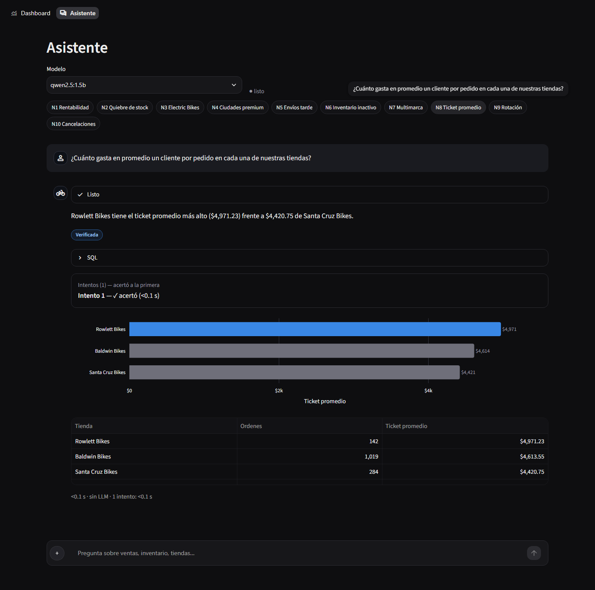
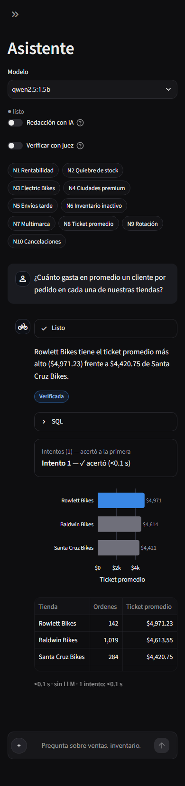
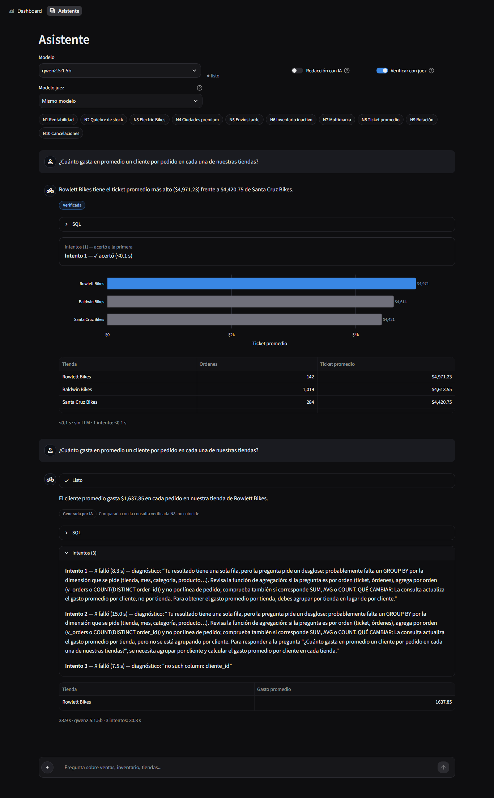
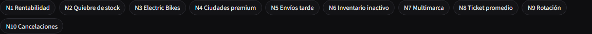
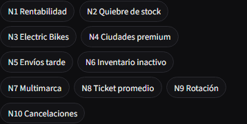

# Fase 9: intentos visibles en el Asistente, accesos directos a las 10 necesidades y juez en vivo

**Modelos:** solo qwen2.5:1.5b, llama3.2:1b y deepseek-r1:1.5b; las mediciones y capturas son con
qwen2.5:1.5b. `qwen3:4b` sigue instalado en Ollama pero no se usó, y el selector "Modelo juez"
solo ofrece los tres modelos soportados. **Nota:** el selector principal "Modelo" lista, como
antes, cualquier modelo local, así que `qwen3:4b` aparece ahí. No lo cambié porque no estaba
pedido.

## 0. Comportamiento por defecto: sin cambios

Con **"Verificar con juez" apagado (por defecto)**, el chat hace exactamente lo mismo que antes:

- Las 10 necesidades se resuelven con la consulta verificada, sin LLM, en <0.1 s.
- Las preguntas libres generan SQL con hasta `MAX_ATTEMPTS = 2` intentos.

Lo único nuevo es que el rastro de intentos se guarda y se muestra. La prueba
`test_toggle_off_verified_route_is_instant_single_attempt` lo comprueba: ruta verificada, <0.1 s,
1 intento y cero llamadas al LLM.

## 1. Rastro de intentos (`sql_engine.QueryResult.intentos`)

Cada entrada tiene `{numero, sql, exito, tiempo_segundos, diagnostico, criterio}`.

| Ruta | intentos |
|---|---|
| verificada | una entrada: SQL verificada, `exito: true`, tiempo real de ejecución, `criterio: "verificada"`. No agrega latencia. |
| llm / llm_anclada (toggle apagado) | una por intento (hasta 2). `exito` = se ejecutó sin error y `diagnostico` = el error real del validador o de SQLite (`criterio: "ejecucion"`). |
| modo juez con referencia | `exito` lo decide el comparador determinista (`criterio: "comparador"`). |
| modo juez sin referencia | `exito: null` si se ejecutó: nadie puede decir si acertó (`criterio: "sin_referencia"`). `false` solo si dio error. |

Añadí `criterio` porque `exito: true` no significa lo mismo en todas las rutas. Sin referencia, solo
se sabe que la consulta corrió. La UI usa este campo para no afirmar "acertó" en esos casos.

## 2. Intentos visibles en el Asistente

Debajo de cada respuesta, junto a "SQL":

- **1 intento (caso normal):** un bloque fijo, no colapsable: «Intentos (1) — acertó a la
  primera» y la línea del intento. Si la ruta fue LLM sin juez dice «se ejecutó a la primera».
  No usé un expander abierto porque Streamlit no conserva `expanded=True` al volver a dibujar el
  historial.
- **2 o más:** el expander «Intentos (N)». Cada línea dice *Intento k — ✗ falló / ✓ acertó / ○ se
  ejecutó (sin referencia para comprobarlo) (t s)* y, si falló, el diagnóstico literal. No hay
  texto de "mejoró" ni "empeoró".
- **Caption:** muestra el tiempo total y además la suma de los intentos, por ejemplo
  `<0.1 s · sin LLM · 1 intento: <0.1 s` o `33.9 s · qwen2.5:1.5b · 3 intentos: 30.8 s`. La
  diferencia entre los dos tiempos es la síntesis.

## 3. Toggle "Verificar con juez"

Está en el encabezado, junto a "Redacción con IA", y viene apagado. Se desactiva si Ollama está
apagado. Su tooltip es el texto pedido. Al encenderlo aparece el selector **"Modelo juez"**:
por defecto es «Mismo modelo» (una sola carga en RAM, otro system prompt); si eliges otro, se
cargan dos modelos.

Con el toggle encendido:

- **Una de las 10 necesidades (ruta verificada):** no se usa la ruta instantánea. El modelo
  contesta solo con el esquema (`answer_with_judge`) y la consulta verificada de esa necesidad es
  la referencia del comparador. El badge sigue siendo **"Generada por IA"**, con un chip
  «Comparada con la consulta verificada N8: coincide / no coincide». Nunca dice "Verificada".
- **Pregunta libre:** el mismo ciclo, sin referencia, y un chip «Revisada por el juez, sin
  respuesta de referencia».
- **Ruta "IA anclada"** (necesidad con un filtro que la consulta verificada no soporta): se trata
  como pregunta libre, porque la respuesta verificada no responde esa variante y no sirve de
  referencia. Es una decisión mía.

## 4. `answer_with_judge(pregunta, modelo, modelo_juez=None, referencia=None, max_intentos=3)`

En cada intento:
1. El modelo genera SQL con `build_system_prompt` (sin enrutador ni anclaje).
2. La consulta se valida y se ejecuta.
3. **Con referencia:**
   - Decide `make_attempt_check` de la fase 8 (comparador más categoría); se corta en el primer
     acierto.
   - Si falla, el feedback es el de `feedback.py` por categoría más la crítica del juez.
   - Esa crítica pasa siempre por el nuevo **`feedback.sanitize`**, que borra todas las cifras y
     cualquier texto que aparezca en la fila de referencia. En la medición real se ve en acción:
     la crítica de N5 quedó «el monto […] de los envíos tardíos».
4. **Sin referencia:** el juez solo comenta la forma de la consulta (columnas que existen, JOINs,
   nivel de agregación). Se hacen los `max_intentos` y se usa el último intento que se ejecutó sin
   error (o el primero, si ninguno corrió).

**El juez (`judge.critique`)** recibe la pregunta, la SQL, el resultado o el error, reglas de buen
SQL y las **otras 9 necesidades**, cada una con su pregunta canónica, la SQL verificada y la
primera frase de su respuesta de referencia. La necesidad que se está respondiendo se excluye
(hay una prueba de esto).
- Solo incluyo la primera frase de cada respuesta para que el prompt quepa en `num_ctx = 4096`:
  medido en Ollama, son **2,898–2,961 tokens**.
- No subí `num_ctx` porque Ollama recarga el modelo cuando cambia y la siguiente consulta SQL
  volvería a recargarlo.
- En el último intento no se pide crítica (no habrá otro) y su diagnóstico es solo el
  determinista.

## 5. Accesos directos a las 10 necesidades

Hay una fila de 10 botones compactos (N1 Rentabilidad, N2 Quiebre de stock, N3 Electric Bikes,
N4 Ciudades premium, N5 Envíos tarde, N6 Inventario inactivo, N7 Multimarca, N8 Ticket promedio,
N9 Rotación, N10 Cancelaciones).
- Siempre están visibles, a 1 clic. Envían la **pregunta canónica exacta** de
  `reference_answers.yaml`, que también aparece como tooltip.
- Las 10 enrutan a su propia necesidad por la ruta verificada (prueba parametrizada). Con el juez
  encendido, el mismo botón muestra el ciclo con referencia.
- Los botones se acomodan en filas: 2 filas a 1366 px y 6 a 390 px, sin desborde horizontal.

## 6. Latencia del modo con juez: qwen2.5:1.5b, CPU, 3 necesidades

Medido con `python tools/medir_juez.py` (guarda `docs/medicion_juez.json`). La "ruta normal" de esta tabla se midió desde el script, contando todo `answer_question` (enrutador incluido); en la app el caption marca <0.1 s. Los tiempos no
incluyen la síntesis; en la app hay que sumarle unos 3–10 s.

| Necesidad | Ruta normal (verificada) | Con juez: total | Generación SQL | Juez | Intentos | ¿Coincide? |
|---|---|---|---|---|---|---|
| N3 Electric Bikes | 0.15 s | **82.5 s** | 34.3 s | 48.2 s | 3 | no |
| N5 Envíos tarde | 0.21 s | **75.7 s** | 30.0 s | 45.6 s | 3 | no |
| N8 Ticket promedio | 0.18 s | **44.7 s** | 16.2 s | 28.4 s | 3 | no |
| N8 en la app (con síntesis) | <0.1 s | **33.9 s** | | | 3 | no |

**Lectura honesta:**
- **El juez no llevó al modelo a la respuesta correcta en ninguna de las 3.** Con qwen2.5:1.5b,
  N3, N5 y N8 ya fallaban 5/5 en la fase 8, y siguen fallando.
- A veces el juez acierta en el diagnóstico (N8, intento 1: «debes agrupar por tienda»). Otras
  veces da un mal consejo: en N3 sugirió «agrupar por brand_name»; en N8, intento 2, pidió agrupar
  por cliente, y el modelo terminó en `no such column: cliente_id`.
- El juez es más de la mitad del tiempo, porque su prompt de ~2.9k tokens se procesa entero en
  cada intento.

**Recomendación para el congreso:** no usar el modo juez en vivo dentro de la demo principal.
Tarda de 45 a 85 s por pregunta, contra <0.1 s de la ruta verificada, y con este modelo
normalmente termina en «no coincide». Sí sirve como **demo aparte, antes o después**, para
mostrar el mecanismo:
- un fallo con su diagnóstico,
- la crítica del juez,
- el comparador determinista diciendo «no coincide», sin que el LLM vote.

Es un ejemplo honesto de por qué el enrutador verificado es necesario con modelos de 1.5B. Si se
quiere mostrar en vivo, N8 es la más corta (~35–45 s).

## 7. Pruebas

`pytest -q`: **346 passed** (21 nuevas en `tests/test_sql_engine.py` y `tests/test_app.py`), sin
Ollama, con LLM falsos.

**Motor:**
- Ruta verificada: 1 intento instantáneo.
- Rastro de la ruta LLM.
- Con referencia, falla en el intento 1 y acierta en el 2: hay 2 entradas y se corta ahí.
- Sin referencia, nunca marca éxito (`exito: null`) y usa el último intento limpio.
- **Fuga:** un juez que escribe la cifra y la tienda correctas y un modelo que solo "mejora" si
  ve ese valor. El modelo sigue fallando en los 3 intentos y el valor nunca llega a su prompt.
- Un solo modelo cuando `modelo_juez` no se especifica: el mismo nombre en todas las llamadas a
  `ollama_manager.chat`. Con `modelo_juez`, el juez usa el otro.

**App (AppTest):**
- Toggle apagado: <0.1 s, 1 intento y sin LLM.
- Toggle encendido sobre N8: usa `answer_with_judge`, muestra «Intentos (2)» con ✗/✓, badge
  "Generada por IA" y chip «coincide».
- Pregunta libre con juez: sin referencia.
- Los 10 botones envían el texto canónico exacto.

## Archivos

- `sql_engine.py`: `intentos`, `Referencia`, `reference_for` y `answer_with_judge`.
- `judge.py`: `critique` y `needs_context`.
- `feedback.py`: `sanitize`.
- `views/asistente.py` y `assets/style.css`.
- `tools/medir_juez.py`, `tools/capturas_fase9.py`.
- `docs/capturas/fase9_*.png`, `docs/medicion_juez.json`.
